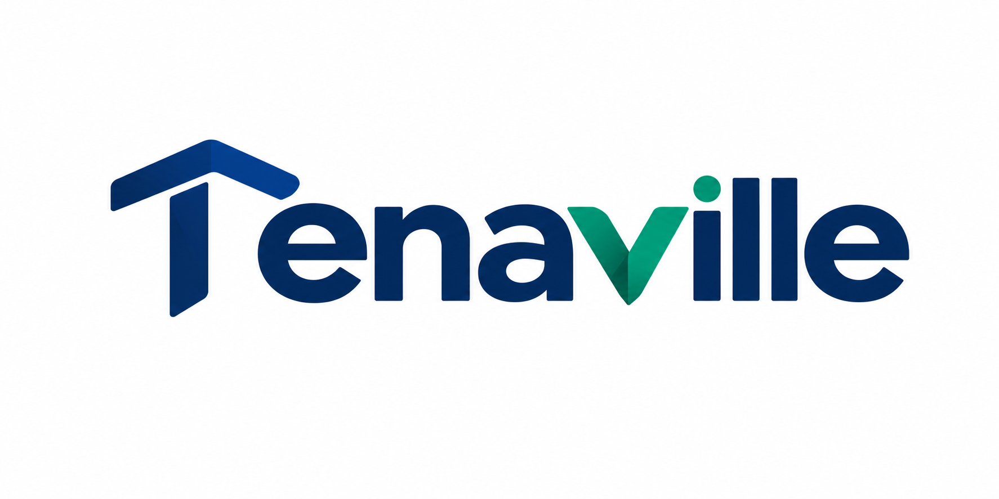

# Tenaville

Property-management platform for Nigerian real estate agencies, property managers and individual landlords. One place for the property, the people, the money, the maintenance and the tenancy lifecycle.

Tenaville is **not a public property marketplace**. No public property search, no listing syndication, no lead selling. See [PRD §4.2](docs/prd/Tenaville_Property_Management_PRD_v3.md) for the full non-goals.

> **Status:** pre-implementation. This repository currently holds the workspace structure, architecture decisions and requirement traceability derived from PRD v3. No feature code yet.

## Repository map

| Path                  | What lives there                                                                                                   |
| --------------------- | ------------------------------------------------------------------------------------------------------------------ |
| `apps/web`            | Next.js app — staff console, landlord portal, tenant portal, and the versioned route handlers the mobile app calls |
| `apps/mobile`         | Expo staff app for field work, offline-capable                                                                     |
| `packages/core`       | Domain modules, one per PRD section 8 area. Business rules live here                                               |
| `packages/db`         | Supabase clients, generated Postgres types, cross-tenant isolation tests                                           |
| `packages/adapters`   | Provider adapters behind stable ports: messaging, payments, financing, storage, identity                           |
| `packages/money`      | Naira as integer kobo, with allocation arithmetic                                                                  |
| `packages/validation` | Zod schemas shared across web, mobile and route handlers                                                           |
| `packages/ui`         | Design tokens and primitives                                                                                       |
| `packages/config`     | Shared ESLint, TypeScript, Vitest configuration                                                                    |
| `supabase/`           | Migrations, RLS policies, seed data, pgTAP policy tests                                                            |
| `docs/`               | PRD, architecture, decisions, requirement traceability, runbooks                                                   |
| `brand/`              | Wordmark and brand assets                                                                                          |
| `tools/`              | Repository scripts, including the traceability check that runs in CI                                               |

## Getting started

```bash
pnpm install
cp .env.example .env.local
pnpm db:start      # local Supabase stack; prints the keys for .env.local
pnpm db:reset      # apply migrations and seed
pnpm dev
```

Requires Node 20.11+ (see `.nvmrc`), pnpm 10, Docker (for the local Supabase stack), and the Supabase CLI via `npx supabase`.

## Working here

Read [CLAUDE.md](CLAUDE.md) first — it holds the invariants that are expensive to discover late: money as integer kobo, append-only financial history, client-fund separation, database-enforced tenant isolation, gapless receipt numbering, and server-authoritative offline sync.

Every PR names the PRD requirement IDs it implements and updates [the traceability matrix](docs/requirements/traceability.md). CI fails if the matrix drifts from the PRD.

## Documentation

- [Architecture overview](docs/architecture/overview.md)
- [Multi-tenancy and row-level security](docs/architecture/multi-tenancy-and-rls.md)
- [Money, ledger and financial integrity](docs/architecture/money-and-ledger.md)
- [Offline sync](docs/architecture/offline-sync.md)
- [Provider adapters](docs/architecture/provider-adapters.md)
- [Data model](docs/data-model/entities.md)
- [Release plan and build order](docs/requirements/release-plan.md)
- [Requirement traceability](docs/requirements/traceability.md) — 194 requirements
- [Architecture decisions](docs/decisions/)
- [Legal and compliance register](docs/legal/compliance-register.md)
- [PRD v3](docs/prd/Tenaville_Property_Management_PRD_v3.md)

## Naming

"Tenaville" is still a working name. Trademark, CAC business-name, domain and app-store checks must clear before any public use (PRD §11, Appendix A). Treat the name as replaceable: keep it in configuration and content, not baked into database identifiers or package names that are painful to rename.
